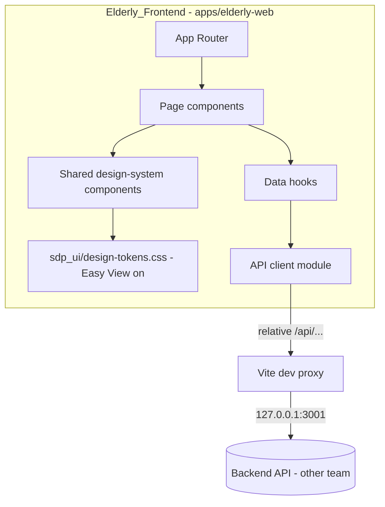
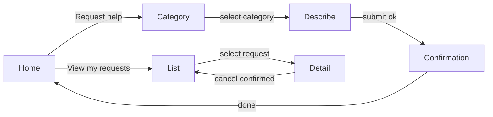

# Design Document

## Overview

This document describes the technical design for the elderly-facing frontend of "Help a Neighbour", a mobile-first React web application for the Sime Darby Property University Hackathon 2026. It implements the requirements in `requirements.md` for the elderly user experience only.

The design is standardized against the team's shared **Township Community Platform design system** (`sdp_ui/DESIGN_SYSTEM.md`, `sdp_ui/design-tokens.css`, and `township_frontend_design_guidelines.md`). That system is the single source of truth for colour, typography, spacing, shape, and the shared component set. This feature does not invent its own tokens or redesign shared components; it consumes them and keeps the elderly screens consistent with the rest of the product.

The design is intentionally scoped to the frontend. The backend API endpoints and the shared contract schemas for help requests and volunteers are **owned by the backend team** and are treated as an external dependency, following the conventions documented in the root `README.md` (import types from `@sdh/contracts`, call relative `/api/...` paths, proxy `/api` to `http://127.0.0.1:3001` in dev, and expect errors shaped as `{ "error": { "code": "...", "message": "..." } }`). Where the frontend must assume a data shape to proceed, the shape is marked **(TBC by backend)** and isolated behind a single API client module so it can be swapped to the real `@sdh/contracts` types with minimal change.

The application lives at `apps/elderly-web/`, is built with React + Vite + TypeScript. Because the audience is older, less tech-savvy residents, the app runs with the design system's **Easy View mode always on** (the `.easy-view` root class): 18px+ body text, 56px control height, simplified wording, and fewer competing choices per screen. This satisfies both the design system and Requirement 1's accessibility baseline.

### Goals

- Deliver the elderly screens: Home, Request Help (category + description), Confirmation, My Requests (list), Request Detail, Cancel flow.
- Reuse the shared design system (tokens + components) rather than bespoke styling, so the elderly app is visually consistent with the general dashboard, youth, and safety modules.
- Run Easy View always on so the Accessibility_Baseline (≥18px body text, ≥44×44px targets with 56px action buttons, ≥4.5:1 contrast) holds on every screen.
- Keep all API coupling behind one client module with clearly flagged assumptions, following the README backend conventions.

### Non-Goals

- The volunteer-facing frontend and the general dashboard's community/safety modules (separate team members; see `sdp_ui/TEAM_FRONTEND_PLAN.md`).
- Defining or implementing backend endpoints or `@sdh/contracts` help-request schemas (backend team).
- Changing or forking shared design-system tokens or components (shared; change only by team agreement).
- Authentication/identity design (assumed handled elsewhere; see Open Questions).

## Design System Alignment

This section records how the elderly frontend maps onto the shared Township Community Platform design system. These are not new decisions; they are the adoption of existing shared rules.

### Source of truth

- Tokens come from `sdp_ui/design-tokens.css`, imported once at the app root. No per-page or per-component hex values (`DESIGN_SYSTEM.md` §9, `KIRO_STEERING.md`).
- Shared components are reused by their canonical names and behaviours (`DESIGN_SYSTEM.md` §5): `AppShell`, `PageHeader`, `AppButton`, `InfoCard`, `StatusBadge`, `FormField`, `EmptyState`, `LoadingState`, `Modal`.
- Font is **Inter** with `system-ui, sans-serif` fallback (`--font-sans`).

### Tokens used (from the shared stylesheet)

- Colour: `--brand-primary` `#D71920` (primary actions), `--brand-primary-hover` `#A61219`, `--page-bg` `#F8F9FA`, `--surface` `#FFFFFF`, `--text-primary` `#1F2937`, `--text-secondary` `#4B5563`, `--border` `#E5E7EB`, `--danger` `#B91C1C` (destructive, e.g. cancel), plus semantic `--success`/`--warning`/`--info` and their `*-bg` pairs for status pills.
- Type scale: H1 30/38 (mobile 26/34), H2 24/32, H3 18/26, body 16/24 — but under Easy View (always on here) body becomes 18px, small text 16px.
- Spacing scale: 4 / 8 / 12 / 16 / 24 / 32 / 48 only.
- Shape: card radius 16px, control radius 12px, pills fully rounded; control height 48px default, **56px under Easy View**; 1px borders with the shared subtle card shadow.
- Focus: visible `:focus-visible` outline (≥2px) with offset.

### Easy View (always on) — Option A

The elderly app applies `.easy-view` at the root permanently. From `design-tokens.css` this sets `--font-body: 18px`, `--font-small: 16px`, `--control-height: 56px`, and bumps button, card-title, label, helper, and error text sizes. This is the design system's intended mechanism for older residents, so Requirement 1.1 (≥18px body) and 1.2 (≥44×44px, here 56px) are met using shared tokens rather than custom overrides.

### Deviations and extensions (within the rules)

- **Status vocabulary**: The design system standardizes report statuses (`Reported`/`In Progress`/`Resolved`) and maintenance statuses (`Scheduled`/`In Progress`/`Completed`). The elderly help-request lifecycle (`pending`/`matched`/`in_progress`/`completed`/`cancelled`) is specific to this feature and not covered by those shared vocabularies. It is rendered through the shared `StatusBadge` style (text + semantic colour, never colour alone), mapping each status to a shared semantic colour family. The human-readable labels are defined in this feature's `status` helper.
- **Routing**: The shared plan assumes a general dashboard with `/community` and `/safety`. The elderly app is a distinct Vite app under `apps/elderly-web/` with its own small route set (below); it adopts the system's tokens and components but not those module routes.

## Architecture



The frontend is a single-page application. Pages compose shared design-system components styled by the shared tokens. Pages never call `fetch` directly; they use data hooks, which call the single API client module. The API client is the only place that knows URL paths and payload shapes, so backend changes are contained there.

### Technology choices

- **React 18 + TypeScript + Vite**: fast dev server with a built-in proxy for `/api` (Req 9.3), matches the monorepo's TypeScript/pnpm setup.
- **React Router**: declarative routes map cleanly to the small, fixed screen set and give a natural back-navigation model (Req 4).
- **Shared design tokens via `sdp_ui/design-tokens.css`**: imported once at the app root; theming, type scale, spacing, and Easy View are controlled centrally (`DESIGN_SYSTEM.md` §9). No bespoke CSS token files.
- **Icon set**: `lucide-react` if icons are used, matching the design system's single-icon-set rule; icons always accompany text labels, never replace them (Req 1.5).
- **Local async state via small custom hooks**: loading/error/retry states for list and detail screens (Req 6.5, 6.6, 9.4) without an extra data-fetching dependency.

## Routing and screens

| Route | Screen | Requirement coverage |
| --- | --- | --- |
| `/` | Home | 4.1, 3.2 |
| `/request` | Choose category | 5.1 |
| `/request/:category` | Enter description + submit | 5.2, 5.3, 5.5 |
| `/request/confirmation` | Confirmation | 5.4 |
| `/requests` | My Requests list | 6.1–6.6 |
| `/requests/:id` | Request detail (+ cancel) | 7.3, 8.1–8.4 |

Navigation rules:
- Every non-home screen renders a labelled "Back" control (text, not icon-only) that calls router back (Req 4.2, 4.3, 1.5).
- Primary navigation exposes at most three destinations; here it is effectively two: "Request help" and "View my requests" (Req 4.4, 4.1).
- One primary task per screen (Req 1.4), consistent with the design system's "single prominent primary action per section".



## Components and Interfaces

### Shared design-system components (reused, not redesigned)

These come from the design system (`DESIGN_SYSTEM.md` §5) and are used as-is. Where this feature needs a thin wrapper, the wrapper only composes a shared component; it does not restyle it.

- `AppShell`: shared page frame — background, max content width, header, and (on wider viewports) the shared navigation. Carries the Sime Darby Property name/logo via `PageHeader`/shell branding (Req 2.3, 3.2). Logo is used only from an approved asset and never modified.
- `PageHeader`: screen heading plus one-line subtitle; optional primary CTA (Req 1.4).
- `AppButton`: variants `primary`, `secondary`, `ghost`, `danger`, with loading and disabled states; 56px height under Easy View; always text-labelled (Req 1.2, 1.5). `danger` is used for cancel.
- `FormField`: input with a persistent visible label, helper text, and error text; 56px field height under Easy View; error tied via `aria-describedby` (Req 1.6, 5.5).
- `StatusBadge`: label + semantic colour (and icon where helpful), never colour alone (Req 1.3, 6.3, 7).
- `InfoCard`: white surface, 16px radius, border, subtle shadow — used for each request in the list and for detail sections.
- `EmptyState`: clear message plus a next-step action (Req 6.4).
- `LoadingState`: consistent spinner/skeleton with an accessible live region and no layout jump (Req 6.6).
- `Modal`: visible title and dismiss control, keyboard-closable with focus handling — used for the cancel confirmation step (Req 8.2).

### Feature wrappers / helpers (this feature)

- `BackLink`: a labelled back control (text, not icon-only) built on `AppButton`'s `ghost` variant; shown on all non-home screens (Req 4.2, 4.3).
- `ErrorNotice`: composes `InfoCard` + `AppButton` to present a structured or generic API error message with a retry action (Req 5.6, 6.5, 8.4, 9.4). Thin wrapper, no new tokens.
- `status` helper: maps `RequestStatus` to human-readable label, to a shared semantic colour family for `StatusBadge`, and exposes `showsVolunteer`/`canCancel` predicates.

### Pages

- `HomePage`: two primary actions ("Request help", "View my requests") and branding via the shell (Req 4.1, 3.2, 1.4).
- `CategoryPage`: exactly three category choices rendered as `InfoCard`-style selectable cards (Req 5.1).
- `DescribePage`: `FormField` for the description; blocks empty submit with an inline error and no API call (Req 5.2, 5.5); on API error shows `ErrorNotice` with retry (Req 5.6).
- `ConfirmationPage`: echoes submitted category and description (Req 5.4).
- `RequestsListPage`: `LoadingState`, `EmptyState`, error, and populated states; each item is an `InfoCard` with category, description, and `StatusBadge` (Req 6).
- `RequestDetailPage`: full detail incl. matched volunteer or waiting text (Req 7); `danger` cancel control for pending with a `Modal` confirm step (Req 8).

### Data hooks

Hooks own async state (idle/loading/success/error) and expose retry.

```ts
function useCreateHelpRequest(): {
  submit: (input: CreateHelpRequestInput) => Promise<HelpRequest>;
  status: "idle" | "loading" | "error" | "success";
  error?: ApiError;
};

function useHelpRequests(): {
  data?: HelpRequest[];
  status: "loading" | "error" | "success";
  error?: ApiError;
  refetch: () => void;
};

function useHelpRequest(id: string): {
  data?: HelpRequest;
  status: "loading" | "error" | "success";
  error?: ApiError;
  refetch: () => void;
};

function useCancelHelpRequest(): {
  cancel: (id: string) => Promise<HelpRequest>;
  status: "idle" | "loading" | "error" | "success";
  error?: ApiError;
};
```

### API client module (the only backend-coupled file)

`src/api/client.ts` is the single boundary to the backend. It follows the README conventions: relative `/api/...` paths (Req 9.1), the dev proxy to `http://127.0.0.1:3001` (Req 9.3), error normalisation into `ApiError` (Req 9.4), and parsing responses with contract schemas once the backend publishes them (Req 9.2).

```ts
// Flagged assumptions — to be replaced by @sdh/contracts when backend defines them.
export type HelpCategory = "groceries" | "transport" | "technology_learning";
export type RequestStatus =
  | "pending" | "matched" | "in_progress" | "completed" | "cancelled";

export interface HelpRequest {        // (TBC by backend)
  id: string;
  category: HelpCategory;
  description: string;
  status: RequestStatus;
  volunteerName?: string;             // present when matched/in_progress/completed
}

export interface CreateHelpRequestInput { // (TBC by backend)
  category: HelpCategory;
  description: string;
}

export interface ApiError { code: string; message: string; }

export const api = {
  createHelpRequest(input: CreateHelpRequestInput): Promise<HelpRequest>; // POST /api/help-requests (TBC)
  listHelpRequests(): Promise<HelpRequest[]>;                             // GET  /api/help-requests (TBC)
  getHelpRequest(id: string): Promise<HelpRequest>;                       // GET  /api/help-requests/:id (TBC)
  cancelHelpRequest(id: string): Promise<HelpRequest>;                    // POST /api/help-requests/:id/cancel (TBC)
};
```

The error shape mirrors the known `ErrorResponse` from `@sdh/contracts` (`{ error: { code, message } }`) with `ErrorCode` ∈ { `VALIDATION_FAILED`, `UNAUTHENTICATED`, `FORBIDDEN`, `NOT_FOUND`, `CONFLICT`, `INTERNAL` }, exactly as defined in the contracts package and documented in `README.md`. The `code` and `message` fields are already real, so error handling can be wired against them now. Everything else above is replaceable without touching pages or hooks.

## Data Models

All models below are **frontend-local assumptions (TBC by backend)**, except `ApiError`, which mirrors the real `ErrorResponse` in `@sdh/contracts`. They are declared only in `src/api/client.ts` and consumed through hooks, so replacing them with published contract types does not touch pages.

### Entities

- **HelpCategory** (enum): `groceries` | `transport` | `technology_learning`. Fixed set of three (Req 5.1).
- **RequestStatus** (enum): `pending` | `matched` | `in_progress` | `completed` | `cancelled` (Req 6, 7, 8).
- **HelpRequest**: a single piece of help requested by the elderly user.
  - `id: string` — unique identifier (used for detail route and cancel).
  - `category: HelpCategory` — the chosen category.
  - `description: string` — non-empty free text describing the help needed.
  - `status: RequestStatus` — current lifecycle state.
  - `volunteerName?: string` — set only when `status` is `matched`, `in_progress`, or `completed` (Req 7.1); absent while `pending` (Req 7.2).
- **CreateHelpRequestInput**: payload to create a request — `{ category: HelpCategory; description: string }` (Req 5.3).
- **ApiError**: `{ code: string; message: string }` — normalised from `@sdh/contracts` `ErrorResponse.error`; drives all error notices (Req 5.6, 6.5, 8.4, 9.4).

### Relationships and invariants

- A `HelpRequest` belongs to exactly one `HelpCategory`.
- A `HelpRequest` is associated with at most one `Volunteer`; the frontend only reads `volunteerName`.
- Invariant: `volunteerName` is present if and only if `status` ∈ { `matched`, `in_progress`, `completed` }. The UI relies on this to choose between showing the volunteer name and the "waiting to be matched" text.
- Invariant: the cancel control is offered only while `status` is `pending` (Req 8.1); after a confirmed cancel the status becomes `cancelled` (Req 8.3).

### Status to UI mapping

Rendered through the shared `StatusBadge` (text + semantic colour family; never colour alone).

| RequestStatus | Human-readable text | StatusBadge colour family | Volunteer shown | Cancel offered |
| --- | --- | --- | --- | --- |
| `pending` | "Waiting to be matched" | info / neutral | No | Yes |
| `matched` | "Matched" | info | Yes | No |
| `in_progress` | "Help in progress" | warning | Yes | No |
| `completed` | "Completed" | success | Yes | No |
| `cancelled` | "Cancelled" | danger | No | No |

## Theming

Theming is **not defined in this feature**. The app imports `sdp_ui/design-tokens.css` once at the root and applies the `.easy-view` class to the shell root (Option A). All colour, type, spacing, shape, and focus styles come from that shared stylesheet (`DESIGN_SYSTEM.md` §2–§4, §9). This feature introduces no new token values and overrides no shared tokens.

Branding specifics inherited from the design system:
- Primary brand red `--brand-primary` `#D71920` for primary actions; `--danger` `#B91C1C` for destructive actions (cancel).
- Page background `--page-bg` `#F8F9FA`, surfaces white, text `#1F2937` / `#4B5563`.
- Hazard/brand red disambiguation and "status is never colour alone" rules apply (`DESIGN_SYSTEM.md` §2, §8).
- These hex values are team-proposed prototype tokens, not asserted official Sime Darby Property brand codes; they are replaced centrally in the shared stylesheet if official assets are provided.

## Error Handling

| Situation | Behaviour | Requirement |
| --- | --- | --- |
| Empty description submit | Inline `FormField` error, no API call | 5.5 |
| API returns `ErrorResponse` on create | `ErrorNotice` with `error.message` + retry | 5.6 |
| API returns `ErrorResponse` on list | `ErrorNotice` with `error.message` + retry | 6.5 |
| API returns `ErrorResponse` on cancel | `ErrorNotice` with `error.message`, keep prior status | 8.4 |
| Non-structured failure (network, 500 w/o body) | Generic failure message + retry | 9.4 |
| List empty | `EmptyState` message + "Request help" action | 6.4 |
| Request in flight | `LoadingState` (accessible, no layout jump) | 6.6 |

All error presentation flows through `ErrorNotice` and `LoadingState`/`EmptyState` so behaviour is consistent with the design system's required shared states and is testable.

## Testing Strategy

- **Unit (Vitest + React Testing Library)**: feature wrappers and pages render the correct state for loading/empty/error/success using a mocked `api`; `status` helper maps every status to label, colour family, and predicates.
- **Design-system conformance**: assert Easy View is applied at the root and that controls use shared component classes (no bespoke token values introduced in this feature).
- **Interaction**: empty-description block (5.5), cancel confirm `Modal` (8.2), retry controls re-invoke the client (5.6, 6.5, 9.4).
- **Accessibility checks**: `vitest-axe` (or `jest-axe`) on each page for contrast/label/role violations; manual check of focus order and back navigation.
- **Responsive**: check at 360px, 768px, and 1440px widths per the design system's acceptance checklist (Req 2).
- The `api` module is mocked in all page tests, so the suite is independent of the backend's final contract.

## Correctness Properties

These properties should hold across the UI regardless of input or API ordering, and are good targets for tests.

- **Property 1 — Category is always one of three:** Any created or displayed `HelpRequest` has `category` ∈ { `groceries`, `transport`, `technology_learning` } (Req 5.1).
- **Property 2 — Volunteer visibility matches status:** The matched volunteer name is shown if and only if `status` ∈ { `matched`, `in_progress`, `completed` }; otherwise the waiting text is shown (Req 7.1, 7.2).
- **Property 3 — Cancel only when pending:** A cancel control is present only when `status` is `pending`, and no API cancel call is sent without an explicit `Modal` confirmation step (Req 8.1, 8.2).
- **Property 4 — No empty requests leave the client:** A create request is sent only when the description is non-empty; otherwise an inline error appears and no API call occurs (Req 5.3, 5.5).
- **Property 5 — Every error path offers recovery:** Any error state (structured `ApiError` or generic failure) renders a message and a retry control; a failed cancel preserves the prior status (Req 5.6, 6.5, 8.4, 9.4).
- **Property 6 — Baseline is never violated:** With Easy View always on, rendered body text ≥18px, interactive targets ≥44×44px (action buttons 56px), and text/background pairs ≥4.5:1 contrast on every screen (Req 1).
- **Property 7 — Single source of truth:** All colour, type, spacing, and shape values resolve to shared `sdp_ui/design-tokens.css` tokens; this feature defines no new hex values and overrides no shared tokens (`DESIGN_SYSTEM.md` §9).

## Open Questions (for the team / backend)

1. **Identity**: How is an Elderly_User identified so `listHelpRequests` returns only their requests? (Session, token, or a demo user id for the hackathon.)
2. **Endpoint shapes**: Final paths and payloads for create/list/get/cancel, and the `HelpRequest` schema in `@sdh/contracts` — owned by backend, per `README.md`.
3. **Logo asset**: The approved Sime Darby Property logo file to display in `AppShell` (used unmodified, per `DESIGN_SYSTEM.md` §0).
4. **Shared component availability**: Are the design-system components (`AppShell`, `PageHeader`, `AppButton`, `InfoCard`, `StatusBadge`, `FormField`, `EmptyState`, `LoadingState`, `Modal`) published as a shared package/folder the elderly app imports, or does each app copy them from `sdp_ui`? This affects how `apps/elderly-web/` consumes them without forking.
5. **Help-request status colours**: Confirm the semantic colour family mapping for the help-request lifecycle with the team so it stays consistent with other modules' status usage.
6. **Volunteer data**: Is only `volunteerName` exposed to the elderly user, or more (e.g., contact, photo)?
