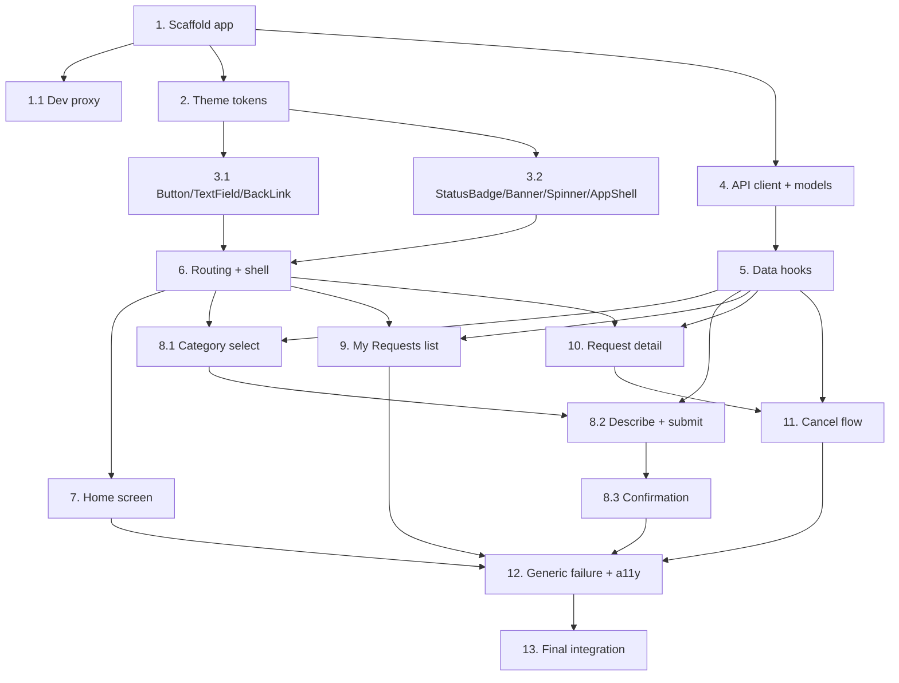

# Implementation Plan

## Overview

This plan implements the elderly-facing frontend described in `design.md`. Work proceeds bottom-up: scaffold and theme first, then the accessible UI kit and the API boundary, then screens that compose them, and finally cross-cutting accessibility and integration passes. The backend API is a dependency; all data access goes through the mocked-in-tests `api` client, so the frontend can be built and tested without the real endpoints.

## Tasks

- [ ] 1. Scaffold the `apps/elderly-web` React + Vite + TypeScript app
  - Create `apps/elderly-web/` with Vite React-TS template, wired into the pnpm workspace and turbo pipeline.
  - Add `dev`, `build`, `test`, `lint`, `typecheck` scripts matching the monorepo conventions.
  - Add a Vitest + React Testing Library setup with a jsdom environment.
  - _Requirements: 9.1_

- [ ] 1.1 Configure the Vite dev proxy for `/api`
  - Proxy requests beginning with `/api` to `http://127.0.0.1:3001` in `vite.config.ts`.
  - Add a smoke test or assertion that the proxy config targets the correct host.
  - _Requirements: 9.1, 9.3_

- [ ] 2. Add Sime Darby theme tokens and global styles
  - Create a single CSS tokens file with custom properties for colour, type scale (`--sd-font-base: 18px`), touch size (`--sd-touch-min: 44px`), and content max width.
  - Apply base body styles (font size, text/background colours) from tokens.
  - Write a test asserting token values meet the baseline (base font ≥18px, touch min ≥44px).
  - _Requirements: 1.1, 1.2, 1.3, 2.3, 3.1, 3.3_

- [ ] 3. Build the accessible UI kit
- [ ] 3.1 Implement `Button`, `TextField`, and `BackLink`
  - `Button` enforces ≥44×44px target, always text-labelled, visible focus ring, with `primary`/`secondary`/`danger` variants.
  - `TextField` renders an associated visible `<label>` and an error region tied via `aria-describedby`.
  - `BackLink` renders a text-labelled back control that calls router back.
  - Unit-test label association, minimum sizing, and focus visibility.
  - _Requirements: 1.2, 1.5, 1.6, 4.2, 4.3_

- [ ] 3.2 Implement `StatusBadge`, `Banner`, `Spinner`, and `AppShell`
  - `StatusBadge` maps each `RequestStatus` to human-readable text and never relies on colour alone.
  - `Banner` shows a message with an optional retry action.
  - `Spinner` exposes accessible loading text via `aria-live`.
  - `AppShell` provides the page frame with Sime Darby logo/name and centred max-width content at ≥768px.
  - Unit-test status text mapping, banner retry callback, and shell branding.
  - _Requirements: 1.3, 2.3, 3.2, 5.6, 6.3, 6.6_

- [ ] 4. Create the API client module and typed models
  - Define `HelpCategory`, `RequestStatus`, `HelpRequest`, `CreateHelpRequestInput`, and `ApiError` in `src/api/client.ts`, flagged as backend-TBC except `ApiError`.
  - Implement `createHelpRequest`, `listHelpRequests`, `getHelpRequest`, `cancelHelpRequest` against relative `/api/...` paths.
  - Normalise both structured `ErrorResponse` bodies and non-structured failures into `ApiError`.
  - Unit-test error normalisation for both cases with a mocked `fetch`.
  - _Requirements: 9.1, 9.2, 9.4_

- [ ] 5. Implement data hooks over the API client
  - Add `useCreateHelpRequest`, `useHelpRequests`, `useHelpRequest`, `useCancelHelpRequest` exposing idle/loading/error/success state and retry/refetch.
  - Unit-test each hook's state transitions with a mocked `api` module.
  - _Requirements: 5.3, 6.1, 6.5, 6.6, 8.3, 8.4, 9.4_

- [ ] 6. Set up routing and the app shell
  - Configure React Router with routes for `/`, `/request`, `/request/:category`, `/request/confirmation`, `/requests`, `/requests/:id`.
  - Render `BackLink` on every non-home screen and limit primary navigation to the two home actions.
  - Test that non-home routes render a back control and home renders both primary actions.
  - _Requirements: 4.1, 4.2, 4.4_

- [ ] 7. Build the Home screen
  - Render "Request help" and "View my requests" actions plus Sime Darby branding, one primary task area.
  - Test both actions navigate to the correct routes and branding is present.
  - _Requirements: 3.2, 4.1, 1.4_

- [ ] 8. Build the help request creation flow
- [ ] 8.1 Category selection screen
  - Present exactly three category choices (groceries, transport, technology learning); selecting one navigates to the describe screen.
  - Test that exactly three choices render and selection routes with the chosen category.
  - _Requirements: 5.1, 5.2_

- [ ] 8.2 Describe-and-submit screen with validation
  - Show a description `TextField`; block submit on empty description with an inline prompt and no API call.
  - On valid submit, call `useCreateHelpRequest`; on API error show the message and a retry control.
  - Test empty-submit block, successful submit calls the client once, and error path shows message + retry.
  - _Requirements: 5.2, 5.3, 5.5, 5.6_

- [ ] 8.3 Confirmation screen
  - After successful creation, show the submitted category and description with a path back home.
  - Test the confirmation renders the submitted values.
  - _Requirements: 5.4_

- [ ] 9. Build the My Requests list screen
  - On open, fetch requests via `useHelpRequests`; render loading, empty, error, and populated states.
  - Each item shows category, description, and human-readable status; empty state offers a create action; error state shows message + retry.
  - Test all four states with a mocked hook.
  - _Requirements: 6.1, 6.2, 6.3, 6.4, 6.5, 6.6_

- [ ] 10. Build the Request detail screen with volunteer display
  - Show category, description, and status; show the matched volunteer name when status is matched/in_progress/completed, otherwise show waiting text.
  - Test volunteer-name-vs-waiting-text branching across statuses.
  - _Requirements: 7.1, 7.2, 7.3_

- [ ] 11. Implement cancel-a-pending-request flow
  - Show a cancel control only while status is pending; require a confirmation step before calling the API.
  - On confirmed cancel, call `useCancelHelpRequest` and update status to cancelled; on error show message and retain prior status.
  - Test: control hidden for non-pending, confirmation gates the API call, success updates status, error retains prior status.
  - _Requirements: 8.1, 8.2, 8.3, 8.4_

- [ ] 12. Add generic failure handling and accessibility verification
  - Ensure non-structured API failures surface a generic message plus retry across flows.
  - Add `vitest-axe` checks on each page and verify responsive single-column layout at 360px and centred content at 768px.
  - _Requirements: 2.1, 2.2, 2.3, 9.4_

- [ ] 13. Final integration pass
  - Run `pnpm lint`, `pnpm typecheck`, and `pnpm test` for `elderly-web` and fix any failures.
  - Manually verify the full flow end to end against a mocked or stubbed API.
  - _Requirements: 1.1, 1.2, 1.3, 9.1, 9.2_

## Task Dependency Graph



```json
{
  "waves": [
    { "wave": 1, "tasks": ["1"] },
    { "wave": 2, "tasks": ["1.1", "2", "4"] },
    { "wave": 3, "tasks": ["3.1", "3.2", "5"] },
    { "wave": 4, "tasks": ["6"] },
    { "wave": 5, "tasks": ["7", "8.1", "9", "10"] },
    { "wave": 6, "tasks": ["8.2", "11"] },
    { "wave": 7, "tasks": ["8.3"] },
    { "wave": 8, "tasks": ["12"] },
    { "wave": 9, "tasks": ["13"] }
  ]
}
```

## Notes

- Each coding task includes its own tests; the `api` client is mocked in all screen and hook tests so the suite does not depend on the backend.
- Tasks 3.1 and 3.2 can proceed in parallel once Task 2 is done; Tasks 9 and 10 can proceed in parallel once Tasks 5 and 6 are done.
- Backend-owned decisions (endpoint paths, `HelpRequest` schema, user identity) remain external; only `src/api/client.ts` changes when they land.
